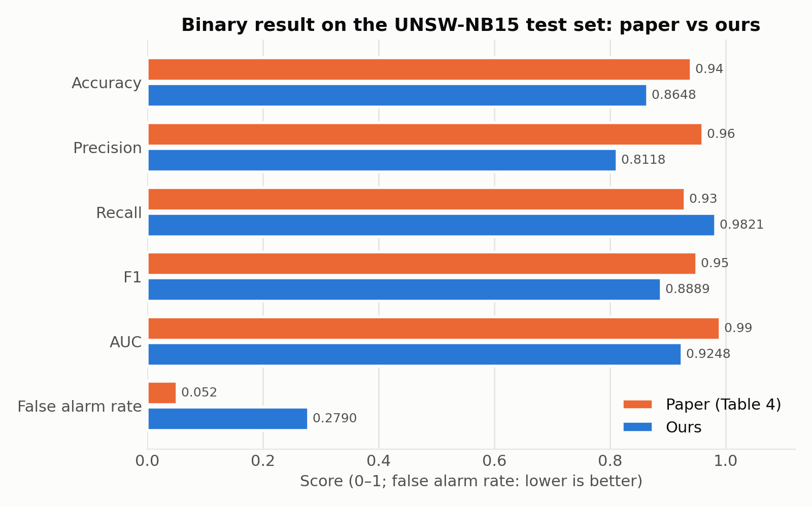
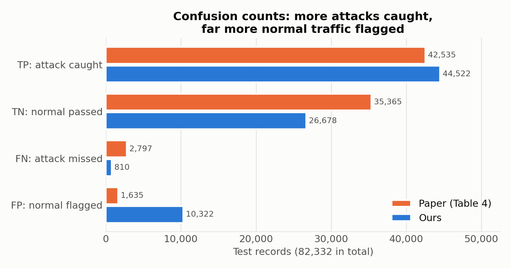
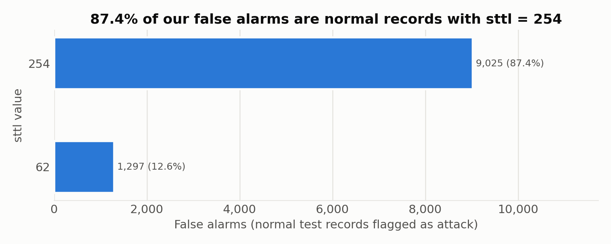
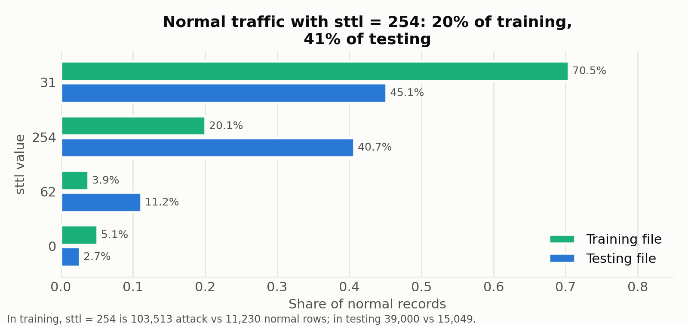
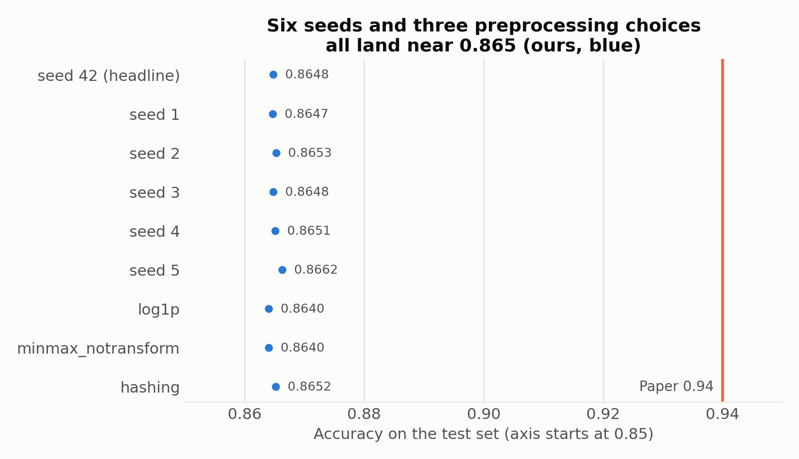
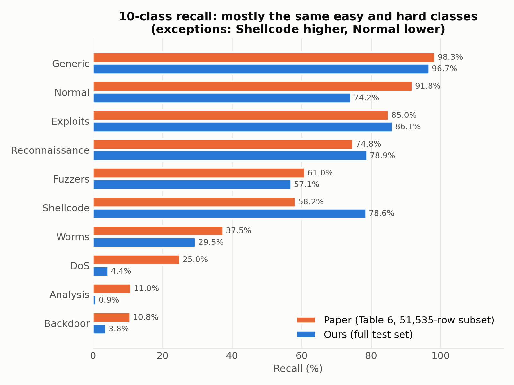

# Figures

Built by `scripts/make_figures.py` from saved results only. Each PNG has a CSV with the exact numbers plotted (table view). Ours = blue, paper = orange. Paper values `paper-reported`; ours `measured` (sources below).

## fig1_table4_metrics

Alt text: Grouped bars of six metrics. Ours is lower than the paper on accuracy (0.8648 vs 0.94), precision, F1 and AUC, higher on recall (0.9821 vs 0.93), and the false alarm rate is 0.2790 vs 0.052.

Data: [`fig1_table4_metrics.csv`](fig1_table4_metrics.csv)

## fig2_confusion_counts

Alt text: Grouped bars of TP, TN, FN, FP. Ours: FN 810 vs paper 2,797; FP 10,322 vs paper 1,635.

Data: [`fig2_confusion_counts.csv`](fig2_confusion_counts.csv)

## fig3_false_alarms_by_sttl

Alt text: Bars of false alarms by sttl value: 9,025 at sttl 254 (87.4%) and 1,297 at sttl 62 (12.6%); none elsewhere. This shows where false alarms concentrate; it is not a tested cause.

Data: [`fig3_false_alarms_by_sttl.csv`](fig3_false_alarms_by_sttl.csv)

## fig4_normal_sttl_shift

Alt text: Grouped bars of the share of normal records at each sttl value, training vs testing. sttl 31: 70.5% vs 45.1%; sttl 254: 20.1% vs 40.7%. In training, sttl = 254 is 103,513 attack vs 11,230 normal rows; in testing 39,000 vs 15,049.

Data: [`fig4_normal_sttl_shift.csv`](fig4_normal_sttl_shift.csv)

## fig5_seeds_variants

Alt text: Dots for six seeds and three preprocessing variants, all between 0.8640 and 0.8662, far left of the paper's 0.94 line. The x-axis starts at 0.85.

Data: [`fig5_seeds_variants.csv`](fig5_seeds_variants.csv)

## fig6_multiclass_recall

Alt text: Grouped bars of per-class recall. Both high for Generic, Exploits, Reconnaissance; both low for DoS, Analysis, Backdoor. Normal: paper 91.8%, ours 74.2%.

Data: [`fig6_multiclass_recall.csv`](fig6_multiclass_recall.csv)

Sources: `results/comparison/2026-11-15_table4`, `results/runs/2026-11-15_error_analysis_stacking_seed42`, `results/runs/2026-11-15_sttl_profile`, `results/runs/2026-11-15_stacking_multiclass_seed42`
